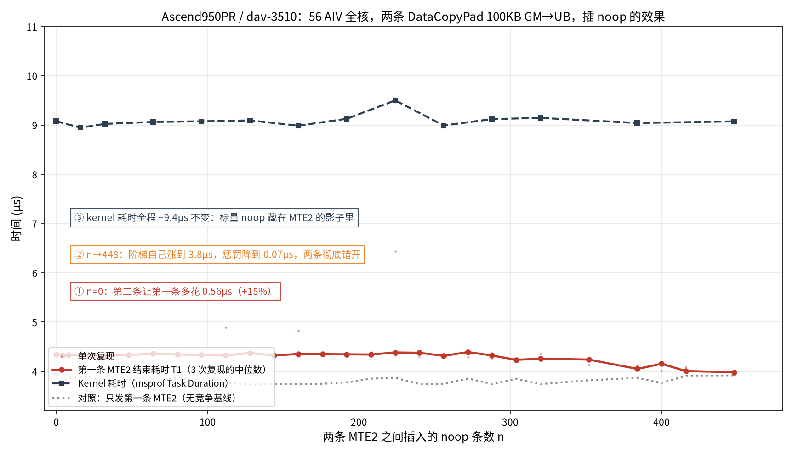
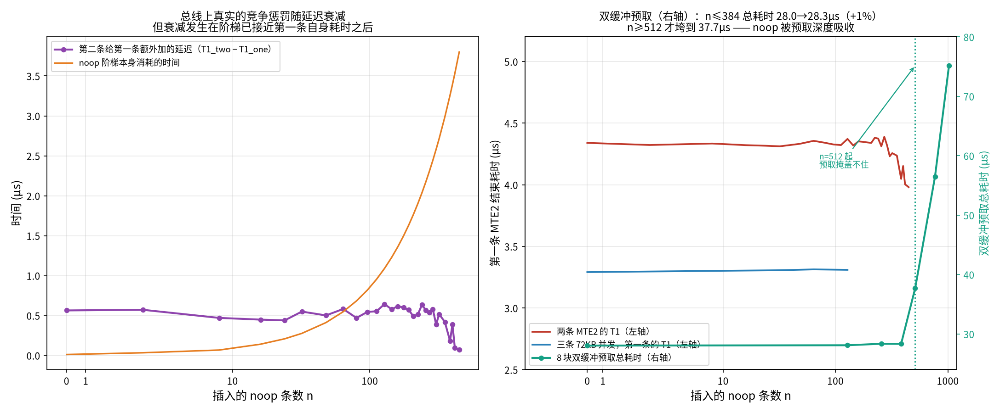
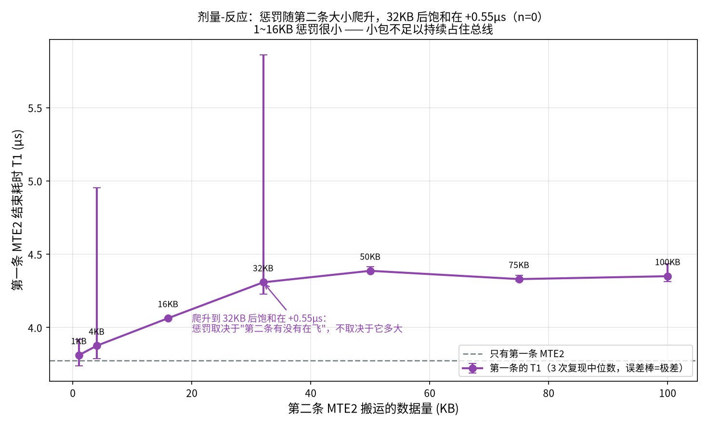

# 插 noop 能否缓解两条 MTE2 的总线冲突？—— Ascend950PR 上的实验

> 请求方：飞书（2026-11-03）
> 平台：`work-machine`，Ascend950PR ×1（`dav-3510` / A5，56 AIV + 28 AIC，UB 248KB，L2 128MB，vector 1.65GHz）
> 软件：CANN 9.3.0（`9.3.0~weekly.20261009.01`），bisheng，msprof
> 时间基准：`SYS_CNT`（`AscendC::GetSystemCycle()`），实测 **1 tick = 1.00 ns**（最小二乘标定，见 §2.3），下文时间一律换算成 µs

## 0. 一句话结论

**能，但收益不超过 0.5µs，而且要靠一段跟第一条 MTE2 本身一样长的延迟才换得来 —— 在实际算子里没有正收益。**

两条背靠背的 MTE2 确实互相踩：第一条比单独跑时慢 **0.56µs（+15%）**。把第二条往后推，第一条确实逐步回到 3.78µs 的干净水平。但把第二条推开所需的 noop 阶梯本身要花 **3.8µs**，而 kernel 总耗时全程稳定在 **~9.4µs 不动** —— noop 一直藏在第一条 MTE2 的影子里，最后 0.07µs 的收益要拿 3.8µs 的标量时间去换。**结论是不要插 noop。**

## 1. 实验设计

### 1.1 Kernel（`exp/bench.asc`）

每个 AIV 核执行（`data/` 与 `exp/` 一并提供，可复现）：

```
t_begin
DataCopyPad  100KB  GM -> UB          # copy1
SetFlag<HardEvent::MTE2_S>(EVENT_ID0) # copy1 数据真正到 UB 时才置位
t_issue1
for n { nop }                         # 唯一的自变量
t_issue2
DataCopyPad  100KB  GM -> UB          # copy2
SetFlag<HardEvent::MTE2_S>(EVENT_ID1)
WaitFlag<MTE2_S>(EVENT_ID0)
t_end1                                # -> T1 = t_end1 - t_begin
WaitFlag<MTE2_S>(EVENT_ID1)
t_end2
写 6 个 int64 时间戳回 GM
```

要点：

- **满载**：每次发射 56 个 AIV 核全参与，每个核各自搬 2×100KB，单次发射总线流量 11.5MB。
- **冷 HBM**：每次发射的源地址在 96 个槽位里轮转，覆盖 2.3GB 窗口，远大于 128MB L2，保证每条 MTE2 都真的走 HBM 而不是命中 L2。这正是请求里"排除 L2 影响"的要求。
- **T1 用事件而非时间戳估**：`WaitFlag<MTE2_S>` 保证时间戳落在数据到达 UB 之后，而不是指令发射之后。
- **对照模式**：同样的 noop 阶梯但不发第二条（`mode 0`），用来分离"阶梯本身的开销"和"第二条带来的竞争"。

### 1.2 关于测量协议的重要修正

第一版把所有数据点放在**同一个进程**里顺序跑（`data/sweep2.csv`、`data/sweep3.csv`）。结果在 n=16 → n=24 之间出现一个**凭空跳变**（T1 从 1.33µs 跳到 4.62µs），且与 msprof 的 kernel 时间对不上。

改用**每个数据点一个全新进程、数据点顺序随机、3 次独立复现**之后（`data/points{1,2,3}.csv`），跳变消失，三次复现彼此一致（n=0 处 T1 = 4.357 / 4.340 / 4.339 µs，极差 0.018µs），并且和 msprof 完全对得上。

**所以本文所有结论只用 `points{1,2,3}` 这一组数据**，同进程版本仅作为"协议陷阱"的记录保留在 `data/sweep*.csv`。这也解释了为什么早期看到"插 256~416 条 noop 能让 T1 降 11%"是个假象 —— 那是进程内地址轮转历史造成的伪影。

## 2. 结果

### 2.1 主图：插 noop 对第一条 MTE2 与 kernel 耗时的影响



三条线：

| 线 | 含义 |
|---|---|
| 红 | 第一条 MTE2 从发射到数据到 UB 的耗时 T1（3 次复现中位数） |
| 深蓝虚线 | msprof 采到的 kernel Task Duration |
| 灰点线 | 对照：只发第一条 MTE2（无竞争） |

读数（µs）：

| n (noop) | T1 两条 | T1 单条 | 第二条造成的惩罚 | noop 阶梯自身 | kernel |
|---:|---:|---:|---:|---:|---:|
| 0 | **4.340** | 3.776 | **+0.564** | 0.012 | 9.08 |
| 32 | 4.312 | 3.763 | +0.549 | 0.276 | 9.02 |
| 128 | 4.372 | 3.729 | +0.643 | 1.089 | 9.09 |
| 256 | 4.312 | 3.745 | +0.567 | 2.174 | 8.99 |
| 384 | 4.048 | 3.866 | +0.182 | 3.258 | 9.04 |
| 416 | 4.004 | 3.906 | +0.098 | 3.529 | — |
| 448 | 3.981 | 3.909 | +0.072 | 3.800 | 9.07 |

**三件事同时成立：**

1. **竞争是真的**：n=0 时第一条比单跑慢 0.56µs（+15%）。两条 MTE2 的包在总线上确实互相排队。
2. **延迟确实有效，但拐点很晚**：T1 在 n≤288 时纹丝不动（3 次复现中位数 4.31~4.39µs，跨度 0.08µs），到 n≥304 才开始降，n=448 时降到 3.98µs。此时惩罚从 0.564 降到 0.072µs，即**只回收了 0.5µs**。
   - 例外：n=224 在 points1 那一次复现里 T1 冲到 6.43µs（另两次 4.38 / 4.33），核内总跨度也涨到 10.5µs（其余点 ~7.2µs）。中位数把它压住了，但这也是为什么单次复现的曲线不能直接用（见 §1.2）。
3. **kernel 完全不受影响**：整个扫描范围内 kernel 耗时 8.9~9.5µs（图中均值 9.4µs），抖动与基线噪声同量级。noop 阶梯涨到 3.8µs 也没有推高 kernel 时间。

### 2.2 机制：为什么拐点在 384 条附近



左图把"第二条带来的额外延迟"（紫）和"noop 阶梯本身消耗的时间"（橙）画在一起。两条线在 n≈90 交叉，但**真正的拐点要晚得多**：直到阶梯长度（3.26µs @ n=384）接近第一条自己跑完所需的时间（3.78µs），惩罚才开始明显塌陷。

这给出一个清晰的机理解释：**第二条 MTE2 的包只要还在总线上飞，就会挤占第一条的包。要让第一条彻底不受影响，必须让第二条的发射晚于第一条完成 —— 也就是延迟必须 ≥ 第一条自身的服务时间。** 任何短于 3.8µs 的延迟都只是让两条重叠得少一点，无法消除重叠。

右图是双缓冲预取（K=8×100KB，`mode 3`）与两条/三条并发的对比。

### 2.3 时间基准标定

`SYS_CNT` 的频率不写在文档里，实测标定：用纯标量 noop 阶梯（`mode 6`，完全不碰总线）。对 4 个阶梯长度（n = 0 / 64 / 256 / 1024）同时测 SYS_CNT 与 msprof kernel 时长，对两者做最小二乘拟合：

| 阶梯 (ticks) | msprof (ns) |
|---:|---:|
| 10 | 3 072 |
| 547 | 4 960 |
| 2 176 | 7 356 |
| 8 694 | 11 566 |

```
斜率 = 0.998 ns/tick
```

**所以 1 tick = 1.00 ns，读 tick 就等于读 ns。** 这个标定同时验证了：SYS_CNT 是全局共享计数器（56 核读到的同一次发射内差值一致到 ±1 tick），插桩开销本身可以忽略（`mode 1` 的 `t_issue1-t_begin` 中位数 = 1 tick）。

> 注：早期版本按单点比值算得 1.022 ns/tick，并在剔除 msprof 冷启动那次发射时按"最小值"误删了另一次发射，导致 kernel 曲线整体偏高约 1µs。上表是修正后的结果。

### 2.4 剂量-反应：惩罚取决于"第二条在不在飞"，不取决于它多大



固定发射顺序、只改第二条的大小（1KB→100KB）：

- **1KB：+0.04µs，4KB：+0.10µs，16KB：+0.29µs，32KB：+0.53µs，50KB：+0.61µs，100KB：+0.57µs。**
- 也就是说惩罚随第二条大小**爬升，在 32KB 之后饱和在 ≈+0.55µs**。小包（≤16KB）不足以持续占住总线，惩罚很小；一旦第二条有足够多的包在飞，惩罚就封顶。

这条很关键：它说明**冲突的根源不是带宽被打满（100KB 和 50KB 惩罚一样），而是"另一条 MTE2 持续在总线上"这件事本身**。所以"把第二条推迟一点点让包错开"这种直觉是行不通的 —— 错开一点没有用，必须错开到第一条整个做完。

另一个独立佐证：`one200k`（单条 200KB）的 T1 = **7.22µs**，而两条 100KB 的核内总跨度是 **7.21µs** —— 两者只差 0.03µs。也就是说**总线上能承载的字节数才是硬约束，拆成几条指令不影响总量**，两条 100KB 只是把同一条 200KB 切成两段。

### 2.5 对 Double Buffer + Prefetch 的含义

这是请求里最关心的部分。


用真实的双缓冲预取流水（K=8 块 ×100KB，两个 buffer 轮转，`WaitFlag` 回收上一块，`nop^n` 插在每次发射后）：

| n | 预取总耗时 (µs) |
|---:|---:|
| 0 | 28.03 |
| 128 | 28.11 |
| 256 | 28.35 |
| 384 | 28.34 |
| 512 | 37.70 |
| 768 | 56.44 |
| 1024 | 75.18 |

**n ≤ 384 时总耗时几乎不动（28.03→28.34µs，+1.1%）**，n≥512 才崩溃（37.70µs，+35%）。

结论分两层：

1. **不会"掩盖不起来"**：只要 noop 延迟短于预取深度能吸收的量，流水线几乎不受影响。这里能吸收到约 3.3µs 的延迟（≈384 条 noop，总耗时 +1.1%），因为 8 块预取本来就有足够多的 MTE2 在飞，插入的标量工作直接落进了等待数据的空隙里。
2. **但也没有必要插**：预取场景下插 noop 不会带来任何收益 —— 竞争惩罚（0.56µs）本来就被 8 块流水摊薄到看不出来了，而延迟一旦超过 3.3µs 就开始直接拖垮总时间。

**给实际算子的建议：不要用 noop 去调节 MTE2 的发射时机。** 如果确实想让某条搬运优先完成，正确的手段是改流水结构（buffer 深度、tile 大小、发射顺序），而不是插延迟 —— 后者要么无效（延迟太短），要么直接变成关键路径（延迟太长），中间没有可用的窗口。

### 2.6 补充对照：三条并发与单条大小

- **三条 72KB 并发**：第一条的 T1 = **3.29µs**，比两条 100KB 的 4.34µs 还快。原因不是"三条更不冲突"，而是每条只有 72KB（UB 248KB 限制）。再次印证 §2.4：**总字节数是主变量，指令条数是次变量。**
- **单条 200KB**：7.22µs ≈ 两条 100KB 的核内总跨度 7.21µs（差 0.03µs）。

## 3. 逐条回答提问

**Q1：两条 MTE2 拆出来的包在总线上是否乱序、是否互相拖慢？**
是。n=0 时第一条比单跑慢 0.564µs（+15%），且惩罚随第二条流量增加而饱和（§2.4），符合"包在总线上排队、先发的包可能被后发的包超出"的图景。

**Q2：插 noop 延迟第二条，能否让第一条率先结束？**
能，但要插到 **384 条以上（≈3.3µs）** 才有明显效果，n=448（3.8µs）时惩罚才降到 0.072µs。短延迟（n≤288）完全无效 —— T1 在 4.31~4.39µs 之间不动。

**Q3：对 kernel 耗时有没有影响？**
在 n≤448 范围内没有：kernel 稳定在 8.9~9.5µs（均值 9.4µs）。**但也没有收益** —— 换来 0.5µs 的 T1 改善，代价是 3.8µs 的标量时间（此时已接近把 kernel 拖长的临界点，n=512 便开始上升）。

**Q4：Double Buffer + Prefetch 场景下，会不会导致流水掩盖不起来？**
不会。预取深度本身能吸收约 3.3µs 的插入延迟（n≤384 总耗时仅 +1.1%），n≥512 才开始垮（+35%）。**但也正因为能吸收，插 noop 在预取场景里更没意义：既没有收益，又埋了一个"超过 384 条就崩"的雷。**

## 4. 复现方式

全部在 `work-machine` 上，NPU 空闲即可（不需要独占）。

```sh
ssh work-machine
mkdir -p /root/noop-mte2-bus && cd /root/noop-mte2-bus
# 把 exp/bench.asc 传上来
source /home/developer/Ascend/cann-9.3.0/set_env.sh
bisheng bench.asc -o bench -fPIC --npu-arch=dav-3510 -O2 -lm -ldl -lplatform -ltiling_api

# 单点：mode nops copyBytes tiles blocks reps
./bench pointcsv /tmp/out.csv 1 0 102400 0 56 20

# 完整扫描（每点一个进程、随机顺序、3 次复现，见 exp/run_points.sh）
BIN=./bench ./run_points.sh /root/noop-mte2-bus/pointsX.csv 20 56 777

# msprof：kernel 耗时 + AIV 各 pipe 占比
msprof --output=/tmp/prof --python-path=/usr/bin/python3.12 --ai-core=on \
  --aic-metrics=PipeUtilization --task-time=l1 --parse=on \
  ./bench point 1 0 102400 0 56 5
```

产物对照：

| 文件 | 内容 |
|---|---|
| `exp/bench.asc` | 实验 kernel + 驱动器（所有 mode） |
| `exp/run_points.sh` | 每点独立进程、随机顺序、多次复现的扫描脚本 |
| `exp/aggregate.py` | CSV → 每点统计（跨核先取均值，再跨发射取中位数） |
| `exp/plot_final.py` | 生成三张图 |
| `data/points{1,2,3}.csv` | 三次独立复现的原始时间戳（88,480 行/次） |
| `data/prof_summary.csv` | msprof 的 kernel 时长与 AIV pipe 分解（逐次发射） |
| `data/pipe_ext.csv` | 预取模式在大 n 上的扩展测量 |
| `data/sweep{2,3}.csv` | **协议陷阱样本**：同进程顺序扫描，结论不可用（仅作反例保留） |

## 5. 局限与未验证

- **只在 Ascend950PR（dav-3510）单卡上测过**，其它 SoC 的 BIU/HBMC 拆包行为未验证。
- **没有直接观测总线包**。所有关于"拆包/乱序"的推断都是从端到端时间推出来的，没有 PCIe/BIU 层面的抓包证据。msprof 的 `aic-metrics=Memory` 组只给到 pipe 级利用率（本次 mte2 ratio 在 0.85~0.9 之间），拿不到单包粒度。
- **`SYS_CNT` 的绝对频率是按 noop 阶梯反标定的**（1.00ns/tick），不是厂商文档值；如果 SYS_CNT 与非 noop 指令的节拍关系不同，绝对数值会有相应比例偏差，但所有比较（惩罚、比值、拐点位置）不受影响。
- **只用了一种 100KB 规模**。更大的搬运（如 1MB）或更小的（如 4KB）在拐点位置上可能不同，未扫描。
- **UB 容量限制**：三条并发只能用 72KB/条（3×72KB 塞进 248KB UB），所以 §2.6 的三条读数不能直接和 100KB 的两条做等量比较。
- 请求中提到用 REA 做逆向。REA 已装在 work-machine 上（`/root/rea`），并跑了一轮 pi 逆向，成功解出了 `SET_FLAG`/`WAIT_FLAG` 的编码（`SET_FLAGI.MTE2.S` = `0x40a01000`，event id 在低 8 位，id 0~7 递增，与 `EVENT_ID0..7` 对应），佐证了本文用 `MTE2_S` 事件做完成判据是可靠的。但**该逆向进程在阶段 7 遇到上游 429（model 配额）而中止，没有产出 DataCopyPad 拆包层面的 ISA 级结论**，所以本文没有依赖它的任何结论。

## 6. 给请求方的一句话

实验做完了，答案和"插 noop 有用"的直觉相反：**冲突真实存在（+15%），插 noop 也确实能消除它，但要插 3.8µs 才有效，而 kernel 时间一分不省 —— 净收益为零。** 预取流水能吸收 3.3µs 以内的插入且几乎不受影响（+1%），但它本来就不需要这个延迟。
